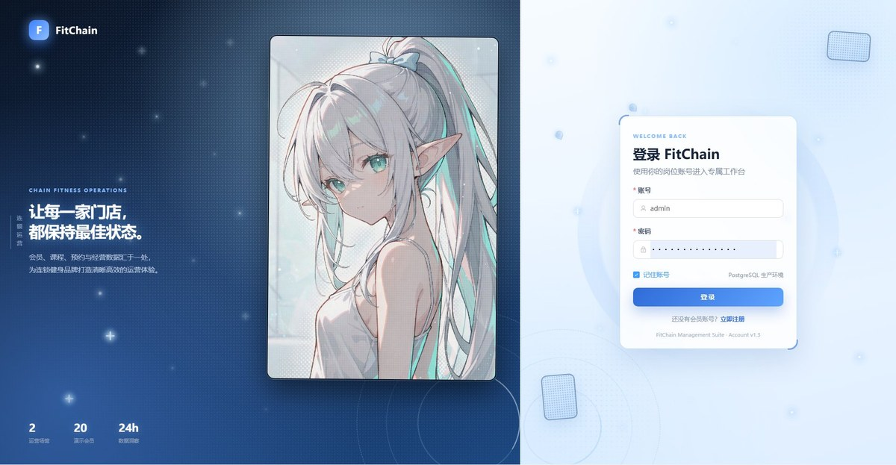
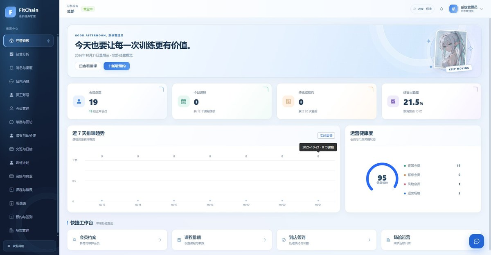
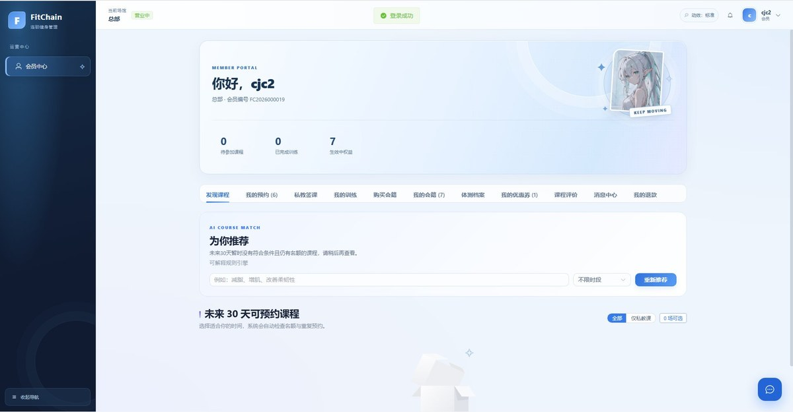
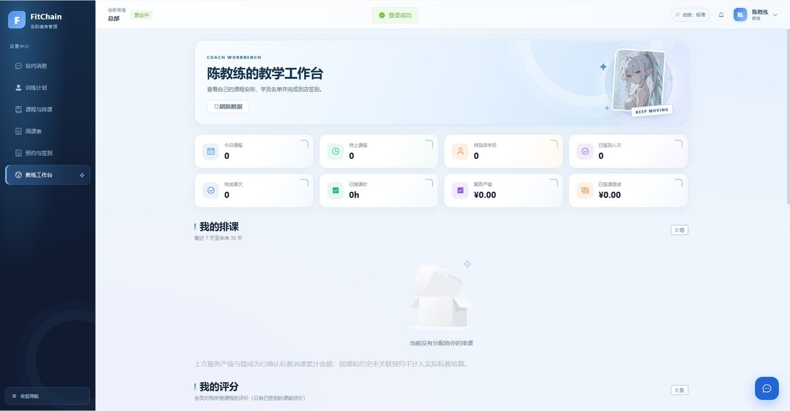
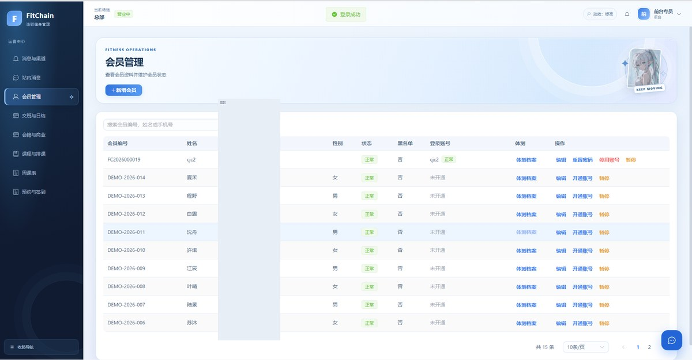

<div align="center">

# FitChain · 连锁健身房管理系统

**一个能真正跑起来的连锁健身房中后台：六角色权限、资金闭环、以及会直接操作页面的 AI 助手。**

[](https://github.com/cjc403/Fitness/actions/workflows/build.yml)
[](LICENSE)
[](https://adoptium.net/)
[](https://spring.io/projects/spring-boot)
[](https://vuejs.org/)
[](CONTRIBUTING.md)



</div>

> **English** — A runnable multi-venue gym management system: six-role RBAC, a money-accurate refund and value ledger, and an in-page AI assistant that drives the tab you are actually looking at (DOM actions, per-write confirmation, server-side verification).

## 界面预览

| 总部经营看板 | 会员中心 |
|---|---|
|  |  |

| 教练工作台 | 会员管理（手机号已隐藏）|
|---|---|
|  |  |

<details>
<summary>手机端 H5</summary>


</details>

## 为什么值得一看

- **六角色权限（RBAC）**：总部管理员 / 店长 / 前台 / 教练 / 会籍顾问 / 会员。权限矩阵写在代码里（`RolePermissionCatalog`），服务端校验门店范围与对象归属——前端隐藏菜单不算安全。
- **资金链路是真的**：全链路按**整数分**计算；实收按折后金额入账；退款按剩余价值核定并回冲价值账；重复请求幂等，并发放款不重复入账。
- **AI 助手不只是聊天**：它能在**你当前打开的页面里**点击、填表、切换页签；写入前冻结真实请求让你**逐次确认**；提交后**回查数据库**核对结果——模型说「成功了」不算数。
- **手机端可用**：H5 复用同一套接口与权限，无需另装 App。
- **工程质量**：后端 **558** 项、前端 **276** 项自动化测试；GitHub Actions 每次提交自动跑。
- **界面花了心思**：冰蓝主题、角色分明的欢迎区、克制的动效，并且尊重系统的「减少动态效果」设置。

## 技术栈

| 层 | 选型 |
|---|---|
| 后端 | Spring Boot 3.5 · Java 17 · Spring Security · Flyway · JPA |
| 前端 | Vue 3 · TypeScript · Vite · Element Plus · Pinia |
| 数据库 | PostgreSQL 18（生产）/ H2（开箱即用的演示模式）|
| 报表 | Apache POI（Excel 导出）|
| AI | DeepSeek（服务端代理调用，密钥不出后端）|

## 快速开始

**前置**：JDK 17、Node.js 20+

```bash
git clone https://github.com/cjc403/Fitness.git
cd Fitness
```

**方式一：零配置演示（H2，不需要装数据库）**

```bash
scripts\run-backend.bat          # 后端：Dev 模式，内置 H2 与演示数据
cd fitness-frontend && npm install && npm run dev   # 前端
```

打开 <http://localhost:5173/login>，演示账号口令统一为 **`password`**（例如 `admin`）。

**方式二：贴近生产（PostgreSQL）**

在本机 5433 端口准备 PostgreSQL 18，然后双击仓库根目录的 `start.bat`：它会检查依赖、初始化数据库、启动前后端并打开浏览器。

**端口**：后端 `8080` · 管理端点 `9091` · 前端 `5173`

## 项目结构

```
fitness-backend/                  Spring Boot 后端（22 个业务模块）
  module/agent/                   AI 助手：意图分流、业务工具、任务账本、结果核验
  module/commercial/              会籍商品、订单、权益、优惠券、跨店分摊
  module/finance/                 退款、价值账、对账
  src/main/resources/db/migration/  Flyway 迁移（只增不改）
fitness-frontend/                 Vue 3 前端
  src/agent/                      页面执行器：观察 DOM → 语义动作 → 真实事件 → 回查
  src/views/                      六角色视图
  src/styles/polish.css           全局视觉层
deploy/linux/                     服务器部署与发布脚本
docs/                             开发与验收文档
```

## 测试

```bash
cd fitness-backend && mvn -B clean package                         # 后端（内存 H2）
cd fitness-frontend && npm test && npm run build                    # 前端 + 类型检查
python -m unittest discover -s deploy/linux -p 'test_*.py'          # 部署脚本
```

## 文档

- [当前功能与待办](docs/当前功能与待办.md)
- [AI 助手如何在页面内操作](docs/六角色电脑Agent_20261016.md)
- [部署（Linux / systemd / nginx）](deploy/linux/README.md)
- [维护约定（含 AI 协作规则）](AGENTS.md)

## 已知问题

- **Linux 上的全量测试尚未适配**：`.github/workflows/ci.yml` 里的测试套件目前在 Windows 上全绿（后端 558 / 前端 276 / 部署 16），
  但在 Linux runner 上仍有失败（路径与换行符等跨平台差异）。因此徽章只反映 **Build**（编译 + 构建）。
  欢迎 PR 帮忙把这些测试跑通 —— 这是很好的第一个贡献。
- **AI 助手的视觉输入尚未接入**：当前通过 DOM 与文字操作页面，不读取截图。

## 贡献


欢迎 Issue 与 PR。动手前请看 [CONTRIBUTING.md](CONTRIBUTING.md)；
**安全问题请勿开公开 Issue**，按 [SECURITY.md](SECURITY.md) 私下联系。

## 许可

[MIT](LICENSE) © 2026 CJC

> 本项目为个人学习与科研实践项目。仓库不含任何生产口令、密钥或真实会员隐私数据；演示数据均为虚构，截图中手机号已遮挡。
