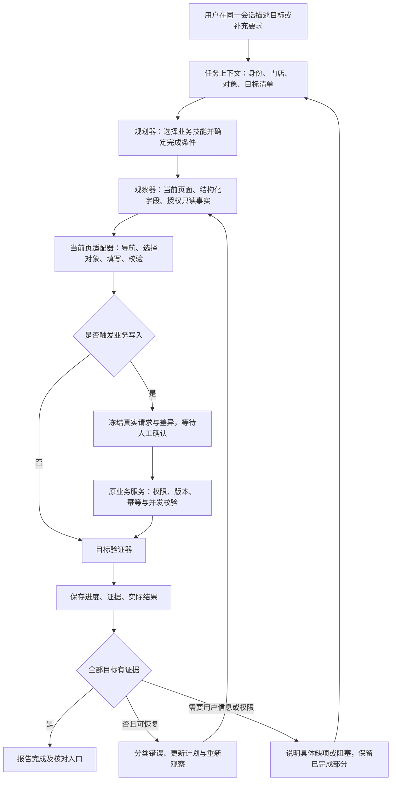

# FitChain 六角色 AI 助手 V2 升级完善计划

> **For agentic workers:** 用户于2026-10-17批准本地实施，使用 `superpowers:executing-plans` 逐项实施；任务用复选框记录。用户已同意缩减第一阶段：沿用已修复任务证据，只对少量新场景随开发验证，完整评测在后期进行，不重新排查已解决问题。

**Goal:** 将现有助手升级为理解 FitChain 业务、能在用户当前网页完成多步骤任务、能核实结果并从常见错误中恢复的六角色业务 Agent。

**Architecture:** 保留 Vue 当前标签页执行方式，在现有 Spring Boot / Vue 内增加任务计划、结构化业务上下文、项目专用页面技能、持续执行记录和独立结果核验。模型负责理解、规划和必要的纠错；确定性的页面适配器与现有业务服务负责实际操作、权限和业务约束；只有与目标逐项对应的事实证据才能产生“完成”。

**Tech Stack:** Java 17、Spring Boot、PostgreSQL / Flyway、Vue 3、TypeScript、Element Plus、现有 Node 浏览器测试；默认继续使用已有 DeepSeek 接口。借鉴开源工程设计，不在本次规划中安装框架或新增云服务。

**Spec:** 本文第 1–10 节为升级设计，第 11–14 节为实施任务与验收约定；一并等待用户批准，不额外拆成多轮重复审批。

**审查日期 / 基线:** 2026-10-17；本地 `codex/computer-agent`，HEAD `65ba12d`，审查开始时工作区干净。此轮只读审查与撰写本计划，未运行模型付费请求、试写业务数据、重新跑功能测试、修改产品源码或连接服务器。历史验收数字只作为已有记录，不能当作本轮实测。

**2026-10-19执行范围调整：** 用户明确要求控制DeepSeek额度，并先收尾交给其验收。重复三轮、剩余扩展故障、视觉及付费性能对比暂缓，不自动续跑。当前交付为本地候选版：100项完成99通过，30项六角色实际写入和12项权限拒绝通过，原360项正式门槛未完成。原计划门槛保留，不改写为通过；详见 `docs/AI助手V2本地验收_20261019.md`。日期查询已知失败待修，不宣称任意任务或商业Agent等效。

## 1. 目标、范围与判断方法

用户重视的是日常使用时能否把事情做成。升级后的体验应当是：用户在会话中描述目标，助手知道当前账号可以做什么，找到正确对象，在当前页面展示并执行操作，需要确认时准确说明将改变什么，最后报告可核对的业务结果；遇到常见障碍时先恢复，而不是立即要求用户重来。

重点解决五类实际问题：

1. 找错课程、会员、联系人或门店；同名对象、重复按钮、分页和长列表导致误定位。
2. 多步骤任务做到一半忘记前提、漏掉后续动作，或无法理解用户的补充与纠正。
3. 页面加载、表单校验、下拉选择、日期输入、网络抖动等常见障碍引发失败或无效循环。
4. 已经保存仍重复保存，或仅完成了点击/填表就声称完成业务。
5. 总部端看起来可用，换成教练、顾问或会员后就缺工具、走错页面或碰到权限错误。

本计划以项目内任务质量为目标。不会预先承诺“所有能力等于 Codex”或“任何指令百分之百完成”；通用商业 Agent 的模型、工具、宿主权限和训练条件与本项目不同。完成率、操作正确性和可恢复性必须用本项目的固定任务集证明。

### Global Constraints

- 用户尚未批准实施：本轮只能交付方案；不修改产品代码、依赖、环境变量、数据库或服务器。
- 后续开发默认本地；本计划获批也不包含上线。服务器发布仍须用户明确要求。
- 操作发生在用户正在看的 FitChain 标签页，未刷新的一段执行保留同一 Page / document；不得退回独立浏览器代做。用户主动刷新恢复会建立新的 document epoch，必须明确记录新旧边界、重新获取租约，不能将旧引用和许可带入新文档。
- 六角色共用引擎，实际操作仍严格受后端角色、门店、服务关系、账号状态和会话约束。
- 所有业务写入继续冻结真实请求并逐次人工确认；模型不能批准自己的操作。计划审批不等于批准某次收款、退款、消息发送或数据修改。
- 不改变现有审批、整数分计算、幂等、名额、权益、版本或并发规则；不自动扣课、追溯改账或重置密码。
- 当前已应用迁移 V1–V23 原字节保留；确需新表时使用实施时下一个空闲版本，当前候选为 V24。
- 验证写入只发生在带显式工程/代理/独占库标记的隔离环境；原账号、密码和真实业务数据保留。
- Key、令牌、完整联系方式、证件和交接文档凭据区不进入模型上下文、前端包、报告或 Git。
- 默认桌面验收。本轮不把手机外观重检列为交付门槛；共用协议和组件必须保持 H5 可用，不引入只能在电脑本机运行的必需能力。若涉及移动布局改动，再单独列出验收范围。
- 不擅自推送 Git、移动每周断点或更新外部平台上的真实业务信息。

## 2. 当前实现审查：已有基础与实际缺口

### 2.1 已有能力必须保留

现有实现已经具备六角色身份、授权查询工具、待确认业务动作、当前网页导航与 DOM 操作、短期控件引用、对象附近上下文、活动弹窗限制、真实请求冻结、单次确认、迟到结果阻断、暂停/停止和基本循环检测。这些不是本轮要重新宣称的新增能力。

已有记录显示前端 274 项通过；最近真实模型验收包含四条课程修改、六角色消息，以及部分暂停和权限负例。此次上线记录还包含移动尺寸和桌面只读验收。它们证明了相应场景，不能推广成任意项目任务都已覆盖。

### 2.2 从当前代码直接确认的限制

| 代码事实 | 对能力的影响 / 需验证的风险 | 升级方向 |
|---|---|---|
| `AgentModelClient.java:101–104` 固定关闭思考，默认配置输出 700 token，非流式 | 复杂规划缺少可调推理预算；是否改善须与同任务基线比较 | 按任务复杂度选择快路径或思考路径，独立输出/超时/限额配置 |
| `AgentModelClient` 的 Completion 不保存 `reasoning_content`；`ComputerAgentService` 重建最近 8 步工具历史且参数统一为 `{}` | 原动作参数和提供方上下文没有完整延续；直接启用思考会出现协议兼容问题 | 服务端保留真实动作与结果，以及提供方所需的完整会话字段 |
| `ComputerAgentService` 只接受 URL、标题、6000 字正文、最多 60 个控件；状态多嵌在文字里 | 已有目标优先仍受预算和启发式命名限制；不等于理解完整业务对象 | 增加对象、字段、表格、分页、验证错误等结构化观察和按需展开 |
| `pageTaskEngine.mjs` 没有持久任务计划；向后端发送最近 12 步，后端再取最近 8 步 | 长任务和补充指令依赖有限摘要；刷新后内存任务丢失 | 明确任务状态、目标版本、子目标、证据和安全检查点 |
| `finish` 主要检查有无动作，以及按关键词判断的写目标是否存在某条成功回执 | 尚无逐项目标核验；一条成功请求未与每个目标、对象和字段建立严格对应 | 类型化完成条件，按对象、字段、提交和只读回查验证 |
| `requestGate` 已冻结请求，但确认卡主要是方法、路径和字段枚举 | 用户不易看出对象是否正确、改前改后差异；回执关联还可增强 | 业务可读差异卡、目标绑定、单次许可及服务端关联回执 |
| `currentPageAgent.ts` 使用固定渲染等待；引擎默认至少间隔 7 秒，每轮调用模型 | 等待可能仍不够或过长；每个小动作都消耗规划机会 | 页面就绪条件、确定性微流程、统一调度与可见超时状态 |
| 多数非过期控件异常使任务结束；模型错误归并为 unavailable / degraded | 界面难以区分参数错误、限流、超时、协议错误和权限不足 | 类型化错误、限定重试、恢复策略和诊断编号 |
| 业务问答与网页任务分别维护会话；网页规划工具主要是点击、填写、选择等通用动作 | 查询到的业务事实不能自然成为同一任务的对象和后续操作依据 | 一个会话入口、一个任务上下文、按角色暴露的业务技能目录 |
| 当前产品没有网页截图传输，模型客户端只接受文字 content | 不能因默认模型支持图片就声称当前助手有视觉 | 后置接入可验证、可脱敏、有能力降级的视觉辅助 |

这些是静态审查结论与由此提出的风险，不是本轮重新复现了所有历史截图中的故障。尤其是“700 token / 关闭思考”不能单独解释全部失败；对象、工具、观察、反馈和验收同样重要。

### 2.3 对照文件

- `fitness-frontend/src/agent/pageTaskEngine.mjs`：状态、循环、完成判断、运行时限制。
- `fitness-frontend/src/agent/pageDriver.mjs`：观察、引用、字段、弹窗和页面动作。
- `fitness-frontend/src/agent/requestGate.mjs`、`src/utils/request.ts`：真实请求确认与回执。
- `fitness-frontend/src/agent/currentPageAgent.ts`：模型调用、资料引用、生命周期。
- `fitness-frontend/src/components/AssistantPanel.vue`、`ComputerAgentPanel.vue`：会话、任务与用户确认。
- 后端 `module/agent/`、`module/agent/computer/`、`module/assistant/service/AgentModelClient.java`。
- `docs/网页Agent可靠性升级_20261016.md` 及 `docs/qa/agent-grounding-20261016/verification.json`。
- `docs/阿里云手机H5发布验收_20261017.md`：只作已有上线证据，本轮未实时复查服务器。
- 仓库外共享交接文档 §0.17 / §10：核对历史与限制，不读取或引用其凭据内容。

## 3. 借鉴方案与技术选择

已通过用户指定的 GitHub 连接器读取以下公开仓库资料；只做研究，没有复制外部提示词为本项目指令，也没有安装这些项目。

| 参考项目 | 值得借鉴的能力 | 在 FitChain 中的落点 |
|---|---|---|
| [Browser Use 的实际系统提示与执行规则](https://github.com/browser-use/browser-use/blob/ccd22fef47a1a36e0c4596fef5db73a5117b9d06/browser_use/agent/system_prompts/system_prompt.md) | 原始目标持续可见；任务计划与执行反馈；完成前逐项核对；循环恢复 | 持久任务清单、真实动作历史、按目标验证，不沿用其多窗口/文件系统权限 |
| [Stagehand 的 observe / act / extract 设计](https://github.com/browserbase/stagehand/blob/10418f98831285b3cddca5328c8013a94f22672a/packages/docs/v2/basics/observe.mdx) | 观察、动作和结构化提取分开；稳定流程复用；失效后重新观察 | 项目专用页面适配器、控件能力契约、受版本约束的技能缓存 |
| [LangGraph 的持久状态与中断](https://github.com/langchain-ai/langgraph/blob/main/README.md) / [持久化](https://docs.langchain.com/oss/python/langgraph/persistence) / [中断语义](https://docs.langchain.com/oss/python/langgraph/interrupts) | 检查点、人工介入、恢复时的状态一致性 | Java 中实现任务账本与检查点；恢复前核对现实状态，不重放已提交动作 |
| [WebArena](https://github.com/web-arena-x/webarena/blob/main/README.md) | 在可复现的自托管业务环境中评价网页任务 | FitChain 独立任务集、固定夹具、结果断言和多轮对照，不照搬其网站或分数 |

路线比较：

| 路线 | 优点 | 主要问题 | 选择 |
|---|---|---|---|
| 只改提示词 / 调大 token | 改动少 | 无法解决对象身份、完整状态、错误恢复和完成证明 | 仅作小部分改进 |
| 整体替换为通用浏览器 Agent | 可复用部分工具 | 容易引入独立浏览器、服务端浏览器托管及新的身份链，与当前页要求和六端约束冲突 | 不作为主线 |
| 在现有架构建设 FitChain 专用 Agent 内核 | 复用真实业务与权限，可见操作，能准确验收 | 需要系统建设任务状态、技能和验证器 | **推荐** |

初版不引入 Python Agent 服务、向量数据库、复杂多 Agent 群或新的付费平台。保留提供方适配接口，但不在没有证据时改成其他模型来掩盖执行器问题。

如实施时确实复用外部代码，先核对所用版本的许可证、依赖和归属要求，保留必要声明；本次读取的 README、示例和系统提示均只作为设计参考，不能未经审查复制成生产执行权限。

## 4. 新架构：统一任务内核，分层执行

规划器、执行器和验证器是职责分离，不意味着每步都启动三个模型。常用技能使用代码检查前置条件和结果；只有意图复杂或恢复需要判断时再调用模型。

### 4.1 一个入口，一套任务事实

- 普通查询直接调用授权只读工具并回答，引用查询时间和数据范围；不为了回答当前已知事实而乱点页面。
- 用户要求操作网页时在当前页执行，显示操作目标、进度和结果。
- 查询后接着说“就修改这门课”时，可以引用同一任务内已经确认的对象；发生同名、换店或过期时重新核对。
- 同时涉及多个独立对象时拆分子目标，不把一次确认扩展为整个批次的许可。
- 从业务问答转为执行仍进入同一任务安全边界，不能从另一个模式绕过待确认写请求。
- 用户的“只修改价格”“不要发送”“先填好不保存”等限制进入结构化禁止项，优先约束后续动作。

### 4.2 任务状态与上下文

任务状态：`PLANNING`、`RUNNING`、`RECOVERING`、`WAITING_CONFIRMATION`、`WAITING_INPUT`、`PAUSED`、`VERIFYING`、`SUCCEEDED`、`PARTIAL`、`FAILED`、`CANCELLED`。

`PARTIAL` 表示部分目标确实完成，其他目标尚未完成；它不是成功率中的成功。`NEEDS_REVIEW` 用作请求结果不确定的阻塞原因，不允许自动重新提交。

每个任务保存：原始目标、目标版本、当前用户/角色/门店/会话摘要、对象引用、子目标、禁止项、当前步骤、已验证证据、错误类别、下一恢复动作、调用与用时预算。只保存业务上必要的信息，不保存浏览器 Cookie 或明文令牌。

对象引用至少含 `entityType / id / venueId / displayName / versionOrFingerprint / source / observedAt`。名称用于展示，ID 和门店用于绑定；“第一个编辑按钮”永远不是业务对象身份。

刷新或进程重启后先显示历史与恢复入口。用户选择继续后，重新验证登录、权限、页面、对象和业务结果，再从安全检查点规划；旧 DOM 引用、未消费确认和请求闭包全部失效。重登后可看本人历史，旧会话的写许可不能复用。

## 5. 升级一：把 DeepSeek 的调用能力正确用起来

### 5.1 按复杂度使用模型

- 常见导航、已注册表单字段及已确认对象的稳定微流程走确定性快路径。
- 多对象、多步骤、约束冲突、前次执行失败时使用思考规划路径。
- 默认仍使用当前 `deepseek-flash` 配置；通过相同任务做“现状 / 新执行器快模式 / 新执行器思考模式”对照，分别看准确率、时延和 token。
- 任务复杂度由请求结构和执行状态判断，用户无需每次手动切换模型。
- 不接受模型自评分作为安全许可；权限、确认和完成判断由代码决定。

### 5.2 协议必须同步改造

DeepSeek 当前官方说明：思考模式的工具调用需要延续 `reasoning_content`；Chat Completions 的思考模式不能使用 `tool_choice=required` 或指定工具，否则可能返回 400。因此不能仅把 `thinking=disabled` 改成 enabled。[思考模式](https://api-docs.deepseek.com/guides/thinking_mode/)、[Chat Completions 协议](https://api-docs.deepseek.com/api/create-chat-completion/)。

实施内容：

1. 将提供方协议封装在 `AgentModelClient` 后的适配层，保留真实工具 ID、参数、结果和必要的提供方字段。
2. 思考路径使用兼容的工具选择方式；模型只返回散文时按无动作处理，最多一次提示修正，不放行未知或多个副作用动作。
3. 提供方内部推理字段仅用于协议连续性，不在用户界面、普通日志或错误报告展示。界面展示任务计划与执行摘要。
4. 当前推理 episode 的完整原始历史在服务端限时、限量内存中保存；重启后从已验证任务账本建立新 episode，不伪造旧的工具调用或推理内容。只有在完整工具调用/结果边界压缩历史。
5. 拆分聊天、规划、执行纠错的输出预算与读超时。建议初始快模式输出 1024、思考规划 8192 token；规划读超时 90 秒、前端规划请求 100 秒，并同步调整返回大小保护。具体以首批协议和质量实验决定，不直接使用当前 700 / 25 秒作为所有路径的上限。
6. 单次任务建议初始限制 60 个动作、最多 3 次重新规划、总活动时间 15 分钟；人工等待从活动时长中分离，待确认许可 2 分钟过期、用户等待 10 分钟后暂停。所有预算可配置，增加预算不是循环的替代方案。
7. 建立用户和全局统一调度。保留限流与熔断，遇到 429 使用提供方等待信息和有界退避；不能一边删掉 7 秒间隔一边仍沿用不匹配的限流。首版同一账号仅 1 个活动任务、全局默认 2 个模型请求并发，按服务器资源和对照实验调节。
8. 区分未配置、余额/认证问题、限流、模型超时、无效 JSON、截断、工具参数不兼容和服务不可用；返回脱敏错误类别及 traceId，不把提供方原始响应直接透出。

以上 token / 时间 / 并发是待实验验证的初值，不是已验证的最佳配置或性能承诺。启用更大输出预算也需要调整 65 KiB 响应、24 条消息等现有保护，改为受 token / 字节 / 完整工具链边界共同约束，仍禁止无界载荷。

## 6. 升级二：让助手理解本项目的业务与页面

### 6.1 角色能力目录与项目知识

建立版本化的业务能力目录，记录功能入口、支持角色、必填字段、时间与金额单位、状态转换、审批要求、可调用只读工具、完成条件和典型限制。事实来自代码契约和已审查说明，不直接把整份交接文档塞进模型。

知识分两类：静态规则按技能检索，动态业务数据通过现有权限服务实时查询。会员数据、余额、名额和版本不进长期缓存；模型不能用旧聊天记录替代当前事实。首版使用结构化目录和关键词/类型检索，资料规模不需要立即建设独立向量数据库。

### 6.2 项目页面技能

首批建设八组技能：

| 技能组 | 支持范围 | 核验重点 |
|---|---|---|
| 页面导航与定位 | 当前角色可访问页面、会员中心页签、列表筛选和分页 | 当前地址/页签/页面正文真的到达目标 |
| 站内消息 | 联系人解析、已有会话、选择收件人、填内容、人工确认发送 | 收件人 ID、内容、真实消息 ID、只发送一次 |
| 课程与排课 | 查找课程、授权改价/容量、填写排课草稿、冲突反馈 | 课程和门店、金额、时间、教练/教室，其他字段不变 |
| 会员与预约 | 精确查找会员、授权建档或编辑、预约、取消和签到 | 身份/权益/名额、临时取消规则、预约状态和记录 ID |
| 潜客与体验 | 本人或授权潜客、跟进、独立体验预约与结果记录 | 负责人、门店、当前版本、顾问与时间 |
| 续费与回访 | 查询授权回访、填写跟进记录、查看会籍事实 | 负责范围、到期时间、记录和下一跟进日期 |
| 训练计划 | 本人服务学员、训练草稿、授权发布/归档、执行和本人反馈 | 训练计划权限、状态、动作快照；不顺带签到扣课 |
| 经营与交班辅助 | 授权经营分析、交班概况、日结差异解释和已有表单准备 | 数据区间、门店、渠道与金额，保留独立复核和审批 |

技能是“对象解析 → 检查前置 → 展示当前页面 → 填写 → 读取校验 → 请求确认 → 核验结果”的可复用流程，不是逐句命令硬编码。界面发生变化时重新观察，无法证明映射可靠时才退回通用 DOM 单步模式。

写入仍从当前页面的实际表单/操作发起并复用已有 API。模型不获得任意 HTTP、SQL、JavaScript、Shell 或新的越权业务入口。新增只读辅助接口也必须使用现有业务访问控制，不能提供跨表任意查询。

### 6.3 页面变为可理解的结构

- 为关键页面加业务语义：对象类型、ID、门店、字段键、动作键、状态和表单版本。语义标记只描述当前账号本来可见的信息。
- `PageContext` 区分当前对象、弹窗、字段、选项、表格行、分页、校验错误、加载/保存状态和观察版本。
- 模型需要找更多对象时调用受范围限制的查找/分页能力，返回总量、当前范围、是否截断；不静默只看前 60 个控件。
- Element Plus 选择器、远程搜索、日期/时间范围、分页、动态表格、重复动作行与富文本输入建立明确控件适配器；文件上传首版只说明限制，不开放任意本机文件读取。
- 页面动作就绪由目标组件完成渲染、相关请求结束、校验反馈和状态变化共同决定。不能等待整个应用永远无网络，也不能只靠固定 400 毫秒。
- 稳定字段可一次规划多个非提交填写动作；每个动作仍检查前置。对象、弹窗、页面或任务版本变化立即停止剩余批次并重新观察，不缓存可直接重放的旧 ref。
- 对同名对象展示门店/编号等区分信息。无法唯一确定时给出有限候选，让用户选一次，不用模糊匹配直接写入。

### 6.4 六角色的具体效果

| 角色 | 升级后优先做好的任务示例 | 必须守住的边界 |
|---|---|---|
| 总部管理员 | 授权跨店查询；准确定位某店某门课程并改价；经营对比与后续页面操作 | 换店先走已有流程；不把总部身份下放其他角色 |
| 店长 | 本店排课、会员运营、体验跟进、交班差异核对和训练监督 | 本店范围；监督不等于取得教练的所有编辑权；保留独立复核 |
| 前台 | 本店会员定位、预约/取消/签到、接待与交班表单辅助 | 不改课程定价、跨店数据或绕过收退款审批 |
| 教练 | 本人课程/学员查询、训练计划创建与授权发布、执行记录和消息 | 服务关系、门店和本人课程；不能给自己提价或修改别人的计划 |
| 会籍顾问 | 本人负责潜客、安排体验、记录跟进、续费回访和消息 | 本人且本店；转化仍必须有真实合格会籍/订单事实 |
| 会员 | 查课、预约与取消、本人训练反馈、站内消息和个人数据查询 | 只操作本人；不进入员工管理页面，不暴露他人资料 |

最终技能准入从现有 `RolePermissionCatalog`、业务访问服务和前端路由共同生成并验证。上表描述优先场景，不自行增加权限；未开放动作明确解释，并给出账号确实可用的下一步。

## 7. 升级三：持续规划、纠错与自然会话

### 7.1 持续计划

例如“找到滨江店的流瑜伽，把价格改成 99，再告诉我这周安排了几节”：

1. 确认当前角色有课程写权限和相应门店访问权。
2. 从当前授权事实中定位唯一课程，固定课程 ID、门店及原值。
3. 在当前页面打开正确课程，展示原价和拟改价，其他字段保持原状。
4. 提交前由用户确认实际冻结请求。
5. 得到属于这门课的成功回执，再查回价格。
6. 按课程 ID 和上海自然周查询排课数量，说明统计范围。
7. 两个子目标都验证后，报告价格变化与排课数；第 6 步失败则报告“改价已完成，排课统计未完成”，不重复第 4 步。

如果用户中途补充“不要动容量，价格改成 109”，目标版本更新，旧计划和旧确认失效，再生成当前差异；已提交结果不能假装撤回。普通澄清、取消和约束修改可在会话内处理，不能要求用户反复新建任务。

### 7.2 分类恢复

| 障碍 | 首选处理 | 禁止行为 |
|---|---|---|
| 页面仍在加载 / 弹窗尚未渲染 | 等待相关组件和目标状态，在截止时间内再观察 | 连续盲点、无界等待 |
| 控件引用过期 / DOM 更新 | 重新观察并按同一业务 ID 绑定 | 按原 ref 或按钮序号继续 |
| 打开错误对象弹窗 | 核对未提交修改，安全退出并定位原目标 | 在错误对象上继续填表或保存 |
| 下拉/分页/远程搜索无结果 | 使用相应控件技能、核对过滤条件和返回范围 | 将当前页空列表断言成全库不存在 |
| 表单校验错误 | 读取字段错误；可确定的格式问题修正一次，缺事实再问 | 随便编手机号、日期、顾问或权益 |
| 版本冲突 / 名额变化 / 教室冲突 | 重新查询并解释变化，重新规划和确认 | 覆盖他人新数据、绕过名额/审批 |
| 无权限 / 首次必须改密 | 立即说明具体限制及可用入口 | 反复重试直到碰运气，或绕开保护 |
| 模型 429 / 临时不可用 | 后端排队和有界退避，显示预计等待信息 | 无限换任务重试或假装已完成 |
| 写请求已发出但回执超时 | 标记结果待核对，以操作 ID/幂等键只读查询结果 | 自动重放写入或重新申请同一操作 |
| 用户手动改页面 / 切店 / 停止 | 暂停，旧动作失效；核对后继续或结束 | 与用户抢操作、释放迟到旧回调 |

每个子目标最多 2 次同类可恢复重试，全任务最多 3 次重新规划；遇到权限、对象不唯一、版本变化或结果不确定时，不用增加重试次数掩盖问题。

会话记忆先限于当前任务和经确认的对象。长期只允许保存用户明确选择保留的偏好，可查看/删除；不积累会员档案、健康信息或跨角色聊天作为永久记忆。页面内容、课程备注和站内消息中的指令属于不可信数据，不能改变用户目标或解除确认。

## 8. 升级四：结果核验、真实回执与用户确认

### 8.1 完成条件不再依赖关键词和一条任意回执

每个子目标都有明确的 `CompletionRequirement`：目标对象、期望字段/状态、读写类型、应有请求、禁止变化和所需证据。

| 任务 | 能报告完成的条件 |
|---|---|
| 打开训练计划 | 当前角色对应入口已出现；当前地址/页签与正文满足条件，原 document 未替换 |
| 修改课程价格 | 正确课程/门店的请求成功；价格回查等于目标；未要求修改的字段无变化 |
| 发送消息 | 收件人 ID、内容、真实消息 ID 对应；重复确认不增加记录 |
| 预约课程 | 会员与排课 ID 匹配；真实预约记录和状态；权益/名额由原服务验证 |
| 创建训练草稿 | 正确学员、计划 ID、草稿状态和动作快照；不顺带发布、签到或扣课 |
| 多步骤任务 | 每项必要条件都有证据；完成一项不能代替其他项 |
| 业务查询 | 授权来源、时间范围、分页完整性清楚；结论与返回事实一致 |

不要求为了读取一个当前已知字段而做一次无意义点击。新的查询型完成条件可以基于真实读取事实，取代当前“至少发生一次 effect 才允许完成”的笼统条件。

### 8.2 确认与服务端证据

- 确认卡首先展示：谁、哪个门店、修改哪个对象、改前/改后、业务影响；完整技术参数折叠展示。
- 一次许可绑定任务 ID、目标版本、用户/会话/门店、方法/路径、规范化请求体 hash、对象和业务版本，单次使用、2 分钟过期。
- 原页面真实请求携带关联 ID。服务端再次验证授权与业务状态，白名单适配写操作的回执与业务提交在同一事务中记录；不能只依赖前端上报“成功”。
- 已有版本字段使用版本校验；没有版本字段的技能以原值摘要配合事务内读取/锁验证，不能用页面旧值覆盖新数据。按实际服务设计实现，不给所有旧表泛加版本改造。
- 双击确认、浏览器/代理重试、两标签页竞争、同任务重复工具调用不能产生第二条业务记录。同一操作 ID 的请求体变化必须拒绝。
- 通用未适配请求仍受现有 gate 保护；如果没有可证明的目标核验器，结果标为待核对，不当作受支持技能完成。
- 所有确认等待中的表单修改、目标修订、换店、身份变化、停止和刷新都会使旧许可失效。已经提交的事实留在账本中，不因任务取消被抹掉。

对于收款、退款、删除、日结复核等敏感流程，只在现有权限和审批流程内提供查询、解释、表单准备和必要的逐次确认，不将通用助手升级变成自动批准业务的入口。

## 9. 升级五：诊断、用户体验与可选视觉

### 9.1 用户看得到进展，也看得懂失败

任务卡展示当前目标、已完成子目标、当前对象、下一步、阻塞原因和核对入口。显示“正在定位课程”“等待保存结果”“因名额变化重新规划”等实际状态，不一直只有“正在处理”。

错误卡说明：哪一步、失败类别、是否已提交、有无需要核对的业务记录、下一恢复方式、traceId。只展示必要的执行摘要，不展示模型内部推理文本。部分完成逐项列出，不让用户误以为全盘失败或全盘成功。

后台记录关联 trace、技能版本、观察摘要、真实动作参数的脱敏形式、结果类型、恢复次数、token 和时间。建立失败聚类：对象识别、控件适配、参数、权限、协议、服务、结果核验；每次真实问题能转成回归案例。默认诊断保留 30 天、任务详情 30 天，敏感请求值按字段脱敏；业务原有审计按其既有保留规则，不能被任务清理删除。

### 9.2 视觉辅助必须真实接入并有明确降级

官方文档目前说明 `deepseek-flash` 可以接收图片；但本项目现在没有网页截图链路。这是两个不同事实。[DeepSeek 图像输入](https://api-docs.deepseek.com/guides/vision/)。

推荐顺序：先完成语义页面、授权事实、业务技能和验证器，再处理图表、图标或结构信息不足场景的视觉理解。

第一步做本地可行性验证：仅从当前 FitChain 业务区域生成可预览、可脱敏的局部图像，验证 Element Plus 浮层、Canvas、跨源素材和遮罩不会漏内容或泄漏资料。DOM 渲染图必须明确标为渲染图，不能当成浏览器真实截图；不能可靠生成的内容不宣称已支持。

若确需浏览器屏幕捕获，必须使用安全上下文和用户授权；当前已有上线记录为 HTTP，不能承诺公网 IP 上可静默捕获。[浏览器 getDisplayMedia 限制](https://developer.mozilla.org/en-US/docs/Web/API/MediaDevices/getDisplayMedia)。手机兼容性不足时正常降级为结构化页面能力，不将外部浏览器或电脑本机程序变成手机必需组件。

图像通过后端图片协议和大小限制传给模型。发送前遮盖隐私字段、助手自身、口令及其他非任务区域；图像默认不持久保存。图片仅辅助对象理解和结果解释，不能越过控件引用、角色权限、请求确认或业务结果核验，也不在全页面盲目坐标点击。

视觉为条件增强项：未通过捕获/脱敏验证时明确记为未交付；核心网页任务仍须独立达到验收标准。HTTPS/域名配置属于未来单独发布工作，不包含本轮计划的实施授权。

## 10. 项目内评测：用任务结果证明升级

### 10.1 冻结 120 个角色任务与独立安全集

每角色 20 个：6 个查询/导航、4 个单项写入、4 个多步骤、4 个可恢复故障、2 个预期拒绝，共 120。六角色合计 108 个应完成任务和 12 个权限负例；权限拒绝单列，不能用来抬高任务完成率。

另设 40 个安全与生命周期案例：恶意页面指令、私有数据隔离、同名跨店、停止/迟到回调、确认过期/篡改、两标签页竞争、先提交后超时、刷新恢复、模式切换、降权和不确定回执。安全用例以可重复的协议/组件/PG 夹具为主，关键链路再跑真实模型浏览器。

108 个正向任务预先分为开发集 72、保留集 36，每角色分别 12/6。由独立评测程序保存预期结果，不把答案送给模型。保留集不能作为提示词示例；若暴露失败后用于调参，必须登记其已转成开发案例，并补充等规模未见用例才再次宣称保留集成绩。

从开发集中选 24 条核心回归，每角色 4 条，包含历史原命令：打开训练计划、给明确用户发送指定消息、精确课程改价、错误弹窗恢复；同时覆盖各角色实际业务，不把同一消息流程复制六遍当作全部能力。

建议的 24 条核心业务方向如下，具体日期、名称、金额和对象由隔离夹具给定，不能替换成生产记录：

| 角色 | 核心1 | 核心2 | 核心3 | 核心4 |
|---|---|---|---|---|
| 总部 | 当前看板打开训练计划 | 指定店课程改价并核对其他字段 | 给指定账号发送精确内容 | 错误弹窗恢复后改课程价格与容量并回查 |
| 店长 | 查询本店本周经营并打开对应页面 | 按授权编辑本店课程 | 本店潜客跟进后准备体验预约，分次确认 | 本店交班差异查询与解释，不代审批 |
| 前台 | 按唯一身份找到本店会员 | 为指定会员预约指定课程 | 按原规则取消指定预约并核对状态 | 为有效预约办理签到并核对结果 |
| 教练 | 本周本人课程查询与页面定位 | 为服务学员创建训练草稿 | 发布本人已有合格训练草稿 | 录入授权学员训练执行并核对动作快照 |
| 顾问 | 本人潜客精确查找及分页 | 新建潜客并核对本人/本店归属 | 为已有潜客安排独立体验预约 | 为本人回访任务添加跟进记录 |
| 会员 | 本周可预约课程查询 | 预约指定课程并核对本人记录 | 按原规则取消本人预约 | 查看本人已发布训练计划并提交反馈 |

正式冻结前须用业务服务核对这些操作在相应角色下确实开放；某个动作未开放时选取同角色已有授权的等价业务用例，并在冻结清单说明，不能为通过评测扩大权限。

### 10.2 如何运行才有说服力

- 在隔离 PostgreSQL 的固定种子夹具运行，每次从已知快照恢复。确认前记录 0 写，确认后验证恰好一条预期提交。
- 基线使用冻结的当前实现，升级版使用同样任务、对象和数据变体；记录模型实际返回标识、配置和运行日期。
- 真实模型功能集运行 3 个独立轮次；为每轮预置可复现的对象/排序变体，旧版和新版成对使用同一变体。
- 除预设用户确认外，不允许人工替助手填字段、选对象或纠正步骤。预先定义的权限/澄清用例按其独立预期判定。
- 标准操作员只在确认内容等于评测期望时点确认；如果助手拟改错对象、错金额或多余字段，拒绝并将该次记失败，不能人工修正后计成功。
- 页面地址、DOM 状态、业务 API 回查、数据库差异和回执关联共同判定结果。模型“完成”、HTTP 200、单元测试数量均不能代替任务成功。
- 环境/模型故障保留原始记录；同时报告端到端完成率和分因统计，不能悄悄剔除失败样本。证据不足和 PARTIAL 均算未完成。
- 先用 12 条代表任务估算调用/时间，按实际 token 与账户配置分批运行并限制总预算；预算耗尽时如实标记未验，不宣称全套完成。不新增未经授权的付费提供方。

### 10.3 拟定交付门槛

| 指标 | 本次升级目标 | 解释 |
|---|---|---|
| 24 条核心回归 | 3 轮全部完成，72/72 | 历史问题和六角色核心路径必须稳定 |
| 108 个正向任务 | 3 轮合计 ≥95% | 至少 308/324；另给开发集与保留集成绩 |
| 每个角色正向任务 | 3 轮各自 ≥90% | 每角色至少 49/54，不能用总部成绩掩盖其他端 |
| 多步骤任务 | 3 轮合计 ≥90% | 24 个任务 ×3，至少 65/72，所有子目标才算完成 |
| 保留集正向任务 | 3 轮合计 ≥90% | 至少 98/108，避免只优化熟悉命令 |
| 未授权/跨店/未确认写入、错误对象写入 | 已测集合 0 次 | 任一出现即阻塞交付；不能被平均成功率抵消 |
| 重复提交 / 回执不明后自动重放 / 假报完成 | 已测集合 0 次 | 逐项核对真实记录与声明 |
| 已有正常业务和生命周期保护 | 全部回归通过 | 不牺牲原系统可靠性换成绩 |
| 速度和成本 | 提交 P50/P95、调用数、token 与基线对照 | 先达到正确性；简单稳定流程争取减少至少 30% 模型调用，属于优化目标，不虚构时延承诺 |

这些是实施后的准入目标，不是当前能力成绩。样本量有限，报告应给轮次和分角色明细，必要时给区间估计，不能推导出“任何任务 95% 成功”。达不到门槛就继续定位或明确缩小支持范围，不把停止报错包装成通过。

## 11. 文件划分与接口约定

新文件名是本计划定义的实施位置；实施时若遇到同时开发冲突，调整文件名必须同步接口和测试，不随意变更职责。

### 11.1 前端

在现有 `fitness-frontend/src/agent/` 增加：

- `contracts.ts`：统一 Task、Goal、EntityRef、Requirement、Evidence、Failure、PageContext 类型。
- `taskCoordinator.ts`：任务、会话与服务端检查点同步；主文档租约及目标修订。
- `taskPlanner.ts`：整理可用技能和任务事实，接收结构化计划；不直接执行写操作。
- `pageContext.ts`：按需结构化读取当前页面，不读取其他标签页或私有 Vue store。
- `skillRegistry.ts`、`skills/*.ts`：角色可用的语义技能与受版本限制的确定性流程。
- `controls/*.ts`：Element Plus 选择、日期/时间、表格和分页适配。
- `outcomeVerifier.ts`：汇总页面证据和服务端核验结果，不能用模型一句 finish 覆盖未满足项。
- `recoveryPolicy.ts`：错误分类到有界恢复动作，写结果不确定直接转核对。
- `diagnostics.ts`：脱敏的可追踪事件和性能数据。
- 条件项 `visionContext.ts`：当前业务区域图像、遮罩与能力判断。

改造而非删除 `pageTaskEngine.mjs`、`pageDriver.mjs`、`requestGate.mjs`、`currentPageAgent.ts`；旧入口通过适配兼容。关键页面先覆盖 `CourseManagement.vue`、`Chat.vue`、`BookingList.vue`、`LeadCenter.vue`、`RetentionCenter.vue`、`TrainingPlanCenter.vue`、`CoachWorkbench.vue`、`AdvisorWorkbench.vue`、`MemberHome.vue`、`CashShiftCenter.vue`、`ScheduleWeek.vue`，按技能逐个添加只读语义/动作注册，避免一次性改所有业务逻辑。

### 11.2 后端

在 `module/agent/task/` 增加：

- `AgentTaskDtos.java`、`AgentTaskController.java`、`AgentTaskService.java`：任务账本、命令版本、准入和恢复。
- `AgentTaskRepository.java` / entity：任务、步骤与证据持久化，按本人和门店范围读取。
- `AgentCapabilityCatalog.java`：按真实授权生成业务能力与参数契约。
- `AgentTaskPlanner.java`：维护提供方 episode、计划和工具上下文。
- `AgentOutcomeVerifier.java`：只使用白名单业务读取核对结果；不信任前端的成功声明。
- `AgentMutationReceiptService.java`：真实白名单业务请求的单次许可、同事务回执及结果查询。
- `AgentTaskDiagnostics.java`：trace 与类型化错误，不输出提供方秘密/完整请求。

模型适配继续由 `module/assistant/service/AgentModelClient.java` 及其拆分文件承担；与原业务 `AgentService / AgentTools / AgentBusiness / AgentActions` 共享授权和查询能力，禁止复制另一套业务权限。原 `/agent/computer/next` 保留兼容；新 `/api/v1/agent/tasks` 系列使用严格字段白名单。

任务记录建议拆为任务表、步骤表、证据/回执表；迁移时限制索引与载荷，明确 30 天任务诊断清理策略，执行计划不得扫描或删除旧业务表。正常业务记录和已有审计与任务清理完全分离。

### 11.3 最小公共契约

- `createTask(goal: string): Promise<TaskView>`：建立服务端任务和当前文档执行租约。
- `reviseTask(taskId, expectedTaskVersion, amendment): Promise<TaskView>`：改变目标，撤销未消费旧许可。
- `observePage(scope: ObservationScope): Promise<PageContext>`：返回有界结构数据与本轮引用。
- `planNext(taskId, expectedTaskVersion, pageContext): Promise<PlanDecision>`：返回技能或单个受支持动作；附前置条件与 requirementIds。
- `runSkill(skillId, args, taskGuard): Promise<StepReport>`：只经当前页面动作；每步校验任务、文档及对象。
- `verifyTask(taskId, evidenceRefs): Promise<VerificationReport>`：服务端事实 + 当前页事实，返回每项目标的 SATISFIED / UNSATISFIED / UNKNOWN。
- `recoverTask(taskId, expectedTaskVersion): Promise<RecoveryDecision>`：重新验证事实；结果不明的写操作只能查询，不能重放。

`PlanDecision` 必须携带 `taskVersion / skillOrAction / typedArguments / requirementIds / preconditions`；任何版本不匹配先重新观察。`StepReport` 的前端结果仅作观察，不能直接签发服务端提交证据。

主文档租约绑定 `taskId / user / sessionHash / venue / documentNonce / leaseVersion`；同账号新文档接管先暂停旧租约。刷新恢复重新签发租约，旧文档迟到请求由服务端拒绝，不能只靠 localStorage 标志阻止。

## 12. 实施任务与每阶段交付

按 M0→M1→M2→M3→M4→M5 执行；M6 是能力门槛明确的视觉增强。每个任务均先写能证明缺陷/契约的失败用例，再实施、回归、记录与本地提交。关键功能按开关启用，未通过的技能不进入对用户可见的“已支持”目录。

### M0 / Task 1：随开发补充代表任务（用户批准的缩减安排）

**Files:** 新增 `fitness-frontend/tests/agent-v2/cases.json`、`fixtures.mjs`、`evaluate.browser.mjs`、`evaluate.test.mjs`；修改 `fitness-frontend/package.json` 增加显式的 `test:agent-v2` 入口，避免当前 `tests/*.test.mjs` 漏掉子目录用例；新增 `docs/qa/assistant-v2-20261017/` 的基线与后续证据，敏感截图不入 Git。

**Interfaces:** 产生固定 caseId、role、goal、setup、expectedOutcomes、forbiddenChanges、confirmationPolicy；评测输出 per-case JSON 和分因汇总，不供模型读取预期答案。

- [ ] 先沿用已修复任务证据，选择少量未充分覆盖任务随开发验证；120功能/40安全和保留集在后期验收前冻结，不阻挡核心开发。
- [ ] 先写评测器失败测试：错误课程虽返回200必须失败、部分完成算失败、负例不计正向完成率、确认卡错字段不能自动确认。
- [ ] 执行评测器专项并确认失败，再实现断言及隔离工程/代理/库标记保护。
- [ ] 随核心功能用最多12条代表任务校验环境、成本与新能力；不补跑完整旧版基线。
- [ ] 基线报告写明覆盖、实际运行数量、未运行和环境故障；本地提交评测器及去敏证据。

**完成标准:** 能以同一任务/夹具公平比较旧版与新版，已知错误不会被评测器判成功。

### M1 / Task 2：模型协议与错误分类升级

**Files:** 修改 `AgentModelClient.java`、`AiProperties.java`、`ComputerAgentService.java` 和对应测试；新增模型调用策略/episode 适配文件。修改配置示例时不写入真实 Key。

**Interfaces:** `complete(ModelRequest, ModelPolicy) -> ModelOutcome`；Outcome 为成功 Completion 或可诊断 Failure，携带 trace、token、finishReason；提供方内部上下文不返回浏览器。

- [ ] 编写协议失败用例：思考+required非法组合、跨轮reasoning回传、截断、多工具/无动作、429、超时、响应过大和密钥不可见。
- [ ] 运行对应 JUnit 选择器确认用例失败；实现兼容模式、完整工具链、独立预算、统一限流与取消截止。
- [ ] 用本机已有受保护配置在隔离环境验证真实工具循环与一次可诊断失败；不切换线上配置。
- [ ] 同任务比较现状、快模式、思考模式，记录收益与代价，按实测选择默认策略。
- [ ] 回归原助手/推荐接口，提交代码、协议证据和配置说明。

**完成标准:** 思考工具链真实可用，错误可归因，不因开启新模式产生400或泄漏内部上下文。

### M1 / Task 3：任务账本、目标版本和安全恢复

**Files:** 新增后端 `module/agent/task/` 账本相关文件和下一个空闲迁移；新增前端 `contracts.ts`、`taskCoordinator.ts`、`taskPlanner.ts`；适配原 engine。

**Interfaces:** 实现 createTask / reviseTask / planNext / recoverTask；所有状态命令有 expectedTaskVersion，写许可另行授权。

- [ ] 编写目标修订、停止后迟到结果、刷新恢复、会话失效、换店、并发标签页租约和重复命令的失败测试。
- [ ] 先确认 H2 与独占 PG 用例失败，再实现任务/步骤/证据账本、乐观状态版本、主文档租约及检查点。
- [ ] 保留已完成子目标与禁止项；提供方历史按完整 episode 管理，重启后重新构建事实上下文。
- [ ] 在隔离库比较迁移前后旧表与密码摘要；验证只新增批准的任务表，恢复不自动释放任何旧确认。
- [ ] 提交迁移、接口契约、生命周期测试和恢复证据。

**完成标准:** 长任务不丢目标；恢复有依据且不会重新提交旧业务。

### M2 / Task 4：结构化观察和控件适配

**Files:** 新增 `pageContext.ts`、`controls/*.ts`；修改 `pageDriver.mjs`、关键页面语义属性；新增真实 Element Plus 浏览器夹具与 Node 测试。

**Interfaces:** `observePage`、结构化 PageContext；控件适配输出规范化值/选项/错误/就绪状态，动作绑定 EntityRef 与观察版本。

- [ ] 编写同名跨店、大于60控件、分页目标、远程下拉、双月日期、时间范围、动态训练动作行和字段校验的失败测试。
- [ ] 确认失败后增加按需观察和控件契约；语义字段只描述当前用户可见对象。
- [ ] 用状态和相关请求替换固定睡眠为主的等待；测试后台轮询存在时仍能正确判断当前表单就绪。
- [ ] 执行原37项页面/引擎专项及新增真实组件夹具，确认过期引用、弹窗和暂停保护保持。
- [ ] 提交观察与控件适配，不捆绑无关页面重构。

**完成标准:** 对象身份唯一、关键字段值与错误可读，列表截断显式，页面变化不能误用旧引用。

### M2 / Task 5：语义技能与六角色业务覆盖

**Files:** 新增 `skillRegistry.ts`、`skills/` 八组适配及后端 `AgentCapabilityCatalog.java`；连接原 AgentBusiness / 业务只读服务，不复制业务写逻辑。

**Interfaces:** `runSkill`；每个技能声明 allowedRoles、requiredPermissions、inputSchema、preconditions、requirements、recoveryHints、skillVersion。

- [ ] 先覆盖原三类命令的失败回归：训练页导航、精确消息、精确课程改价；每个角色选择4条真实核心任务。
- [ ] 逐组实现业务对象解析和页面适配，每次先跑该组失败测试再提交实现。
- [ ] 对同名对象、无权限、未知对象、缺参数和日期歧义，分别验证候选选择或具体说明；不能泛化为无限 ask_user。
- [ ] 将“先查询再操作”、会员内部页签、教练服务学员、顾问本人潜客、店长本店和总部换店纳入核心链。
- [ ] 每组提交后在隔离环境跑对应真实模型任务和其他角色负例，记录支持范围；未通过不暴露技能。

**完成标准:** 八组技能的授权路径有明确支持清单，六角色都有可完成的实际业务，不只测试消息。

### M3 / Task 6：逐目标验证和服务端回执

**Files:** 新增 `outcomeVerifier.ts`、`AgentOutcomeVerifier.java`、`AgentMutationReceiptService.java`；修改 requestGate / request.ts、白名单业务服务的事务回执接点与任务确认接口。

**Interfaces:** `verifyTask`、单次任务许可、规范化payload hash、receiptRef；事务内写操作与receipt共享成功/回滚结果。

- [ ] 先写错误对象回执、任意回执冒充多目标完成、改价成功但统计未完成、前端伪造receipt、确认过期/篡改的失败测试。
- [ ] 在独占 PG 写并发、重复确认、同操作不同参数、提交成功但返回超时、业务回滚时不得有成功回执的测试。
- [ ] 确认失败后实现许可与事务回执，再按技能增加受权限约束的只读后置核验；无版本业务使用事务内原值校验。
- [ ] 对每个支持写技能核对确认前0、确认后1、重复拒绝、错误对象0、未请求字段不变和停止后0新增。
- [ ] 新旧确认接口回归通过后提交，旧业务审批和金额/权益规则不得降级。

**完成标准:** 完成状态必须逐项目标有证据；未知提交结果不能自动重放，记录与许可不能由前端伪造。

### M3 / Task 7：有界恢复与自然补充

**Files:** 新增 `recoveryPolicy.ts`；修改 taskPlanner / coordinator / engine 与助手会话处理；增加故障注入夹具。

**Interfaces:** `classifyFailure -> RecoveryDecision`；恢复动作只能来自白名单，所有补充更改 taskVersion。

- [ ] 编写旧错误弹窗、校验提示、控件迟到、429、版本冲突、名额变化、断网、用户改价指令修订和不确定回执的失败测试。
- [ ] 确认失败后实现分类恢复、2次同类重试/3次重规划限额、具体补充问题及已完成结果保留。
- [ ] 验证“改成109/不保存/只改价格”撤销旧确认，不能让旧模型结果填回旧值。
- [ ] 故障注入后核对请求数量、对象和副作用；支持恢复的案例应自行恢复，权限/不唯一/未知提交应明确暂停。
- [ ] 提交恢复证据与常见失败说明。

**完成标准:** 可恢复问题继续完成，不能恢复的问题有具体原因；恢复不重复已成功业务。

### M4 / Task 8：统一体验、项目知识与诊断

**Files:** 修改 AssistantPanel / ComputerAgentPanel；新增角色能力说明、业务知识目录、diagnostics.ts / 后端诊断文件和脱敏测试。

**Interfaces:** 会话引用 taskId；UI 按 TaskView / VerificationReport 展示状态，不自行推断完成。

- [ ] 编写模式切换绕过确认、会话引用错对象、PARTIAL展示、不同用户历史隔离、知识含凭据/提示注入的失败测试。
- [ ] 确认失败后统一会话、查询与任务上下文，添加进度、差异卡、具体错误和安全恢复入口。
- [ ] 建设按技能检索的项目规则，动态事实仍实时读取；不加入整份交接文档或永久会员档案。
- [ ] 添加调用数、token、时延、恢复/失败类别和trace查询，验证日志/诊断导出脱敏与30天任务诊断清理。
- [ ] 验证传统手动业务、原助手问答和权限不退化后提交。

**完成标准:** 用户无需理解多个执行模式就能完成任务，维护者能凭trace定位失败环节。

### M5 / Task 9：完整评测、性能优化与本地交付

**Files:** 完成评测器、`docs/qa/assistant-v2-20261017/`、验收说明、共享交接 §0.17 / §10；更新 AGENTS 当前状态但保留默认本地规则。

**Interfaces:** 输出 `baseline.json`、`candidate.json`、`comparison.json`、`failure-catalog.json`、`verification.json`，包含模型/技能/代码版本与样本分母。

- [ ] 完成108正向与12权限任务的3轮真实模型验证，按第10节阈值统计；另完成40安全案例及关键真实模型复验。
- [ ] 对失败逐项修复并补回归，保留失败证据；复用过保留集必须登记和补充新案例。
- [ ] 正确性通过后优化稳定微流程和上下文预算，重新比较调用数/token/时延；不能为提速合并用户确认或少做核验。
- [ ] 跑前端全量测试与生产构建；后端在新鲜TEMP源码副本完整package，显式启用独占 PG 的任务/回执并发用例。改动执行器时再跑其测试，否则如实引用原结果。
- [ ] 审查权限、事务边界、确认重放、日志敏感信息和任务恢复；运行新旧界面兼容与回退开关验证。
- [ ] 形成可在本地实际演示的六角色清单、升级前后数据和未支持能力；维护共享交接但保留凭据段原字节。
- [ ] 只本地提交，不推送、不发布。等用户体验确认并明确要求上线，再另做发布计划和服务器验证。

**完成标准:** 第10节门槛有原始证据，产品展示与实测成绩一致；数据和安全没有退步。

### M6 / Task 10：条件视觉增强

**Files:** 条件新增 visionContext / 图片协议适配 / 遮罩测试；不强制增加浏览器托管服务或本机执行器。

**Interfaces:** `captureBusinessRegion -> ImageContext | UnsupportedCapability`；图片仅限用户允许的当前业务区域，带来源和脱敏结果。

- [ ] 先做第9.2节的捕获能力与隐私验证，包含浮层、Canvas、跨源内容、HTTP限制与不支持环境降级。
- [ ] 可行后先写图片载荷、遮罩、大小、禁止敏感区域、上传失败降级的失败用例，再接通模型真实图像理解。
- [ ] 证明图片在特定任务上提供新增信息；不把DOM文字识别结果当作视觉验证。记录对准确率、时延和token的增减。
- [ ] 视觉不能自行点击未知坐标、绕过确认或扩大权限；关闭后全部核心任务仍通过。
- [ ] 如无法可靠脱敏或支持环境受限，明确保留为未交付增强，不影响核心Agent验收，不冒称已启用视觉。

**完成标准:** 有真实且可说明的图像输入能力与降级结果；只有满足条件的环境才显示该能力。

### 各任务的验证入口

实现时使用以下确定的测试入口；不存在的文件由对应任务先创建。Node 命令在 `fitness-frontend` 目录执行。任何真实模型浏览器脚本先断言工程、前端代理和独占库标记，失败即拒绝登录/写入，不提供跳过保护的开关。

| 任务 | 新增专项测试 | 执行入口与通过条件 |
|---|---|---|
| Task1 | `tests/agent-v2/evaluate.test.mjs` | `node --test tests/agent-v2/evaluate.test.mjs`；错误对象、部分完成、负例分母等评测器断言通过 |
| Task2 | 后端 `AgentModelClientTest`、新增 `AgentModelPolicyTest` | 新鲜TEMP副本 `mvn -B -Dtest=AgentModelClientTest,AgentModelPolicyTest test`；失败协议样例被精确分类，合法会话往返通过 |
| Task3 | 后端 `AgentTaskServiceTest`、`AgentTaskPostgresTest`；前端 `task-state.test.mjs` | 普通JUnit与显式独占PG执行；`node --test tests/agent-v2/task-state.test.mjs`；租约/任务版本/恢复断言通过 |
| Task4 | `page-context.test.mjs`、`controls.test.mjs`；真实浏览器 `controls.browser.mjs` | `node --test tests/agent-v2/page-context.test.mjs tests/agent-v2/controls.test.mjs`；真实Element Plus夹具同样通过，不能只用假DOM |
| Task5 | `skills.test.mjs`；后端 `AgentCapabilityCatalogTest` | 角色×技能×权限矩阵通过；`evaluate.browser.mjs` 按冻结清单执行指定角色核心任务并输出业务断言 |
| Task6 | `outcome.test.mjs`；后端 `AgentOutcomeVerifierTest`、`AgentMutationReceiptPostgresTest` | 正反例及事务/并发/回执丢失PG用例实际执行，无跳过；不以H2通过代替PG结果 |
| Task7 | `recovery.test.mjs`、`amendment.test.mjs` | `node --test tests/agent-v2/recovery.test.mjs tests/agent-v2/amendment.test.mjs`；恢复次数、有副作用请求数与目标版本精确断言 |
| Task8 | `assistant-contract.test.mjs`、`diagnostics.test.mjs`；后端 `AgentTaskPrivacyTest` | 会话/模式/历史隔离和脱敏通过；页面真实交互与trace字段检查通过 |
| Task9 | 上述全部；冻结功能/安全集 | `npm test`、新增 `npm run test:agent-v2`、`npm run build`；新鲜TEMP `mvn -B clean package` 与独占PG专项；逐一报告执行数、跳过数和浏览器成绩 |
| Task10 | `vision-context.test.mjs`；后端 `AgentVisionPayloadTest` | 遮罩和协议用例通过，再验证真实图片；不支持环境返回明确降级，图像不可用仍通过核心任务 |

`test:agent-v2` 明确运行子目录的 `*.test.mjs`；浏览器/真实模型脚本使用独立入口，不能混入普通单元测试默认发付费请求。完整报告记录每条实际命令和返回结果；计划中的入口不是已经执行的命令。

## 13. Review Focus 与发布风险控制

五个最容易遗漏的情况，及其归属测试：

1. **同名对象同时跨店存在，页面还残留错误弹窗。** Task4/5/6 必须证明唯一ID/门店绑定、弹窗恢复及错对象0写。
2. **业务已提交但响应丢失，任务刷新后恢复。** Task3/6/7 必须证明只读回查、原事务回执、旧许可失效和不重放。
3. **用户修订目标或换店时旧模型请求、表单校验仍挂起。** Task3/4/7 必须验证taskVersion、文档租约与旧回调阻断。
4. **六角色授权差异与后台数据变动，而前端显示仍是旧身份/旧版本。** Task3/5/6 必须重验服务端角色、关系、名额与对象版本，不能依据缓存权限放行。
5. **思考/视觉/长上下文超出旧传输边界，或者模型失败被错误描述成业务成功。** Task2/8/10 必须验证完整协议、载荷界限、脱敏与UNKNOWN结果处理。

交付方式：新内核、思考模式、各组技能和视觉分别有开关。先在隔离环境按角色启用，验证后才启用本地日常版本；关闭开关可回到旧助手入口。新表为附加记录，不能为了回退自动恢复旧业务库。旧版也保留新写许可的安全拒绝，不允许通过回退释放正在等待的旧提交。

服务器资源按已有小型实例约束设计：不常驻六个浏览器或六个大模型执行进程；页面动作在各用户浏览器完成，服务端限制推理并发、任务载荷和诊断保留。是否需要扩容由实测决定，不在此预先承诺或购买。

## 14. 交付物、顺序与用户审批内容

批准后推荐按顺序完成：

1. **先看到真实基线和模型协议改善**：先找失败集中在哪，修正思考调用与错误诊断。
2. **再看到三个历史问题和六角色核心任务稳定完成**：任务状态、结构观察和第一批技能闭环。
3. **再看到多步骤、恢复和真实结果核验**：把单场景修补提升为通用机制。
4. **最后扩大八组业务覆盖并交付质量对照报告**：达到门槛后再做性能优化；视觉单列条件验收。

正式交付包含：可运行的本地版本、六角色技能目录、120任务与40安全案例及分集说明、升级前后对照报告、失败与未支持范围、实际演示步骤、回退开关说明和双方维护的共享交接记录。

不以“加了多少行提示词”“换了哪个模型”“单元测试增加多少”替代交付。每阶段都要回答：以前哪类任务失败、现在用什么机制解决、真实验证能否证明、还有哪些没做到。

**用户已批准整份本地升级及缩减第一阶段的安排。实施进度与验证结果单独记录；服务器仍未更新。**
